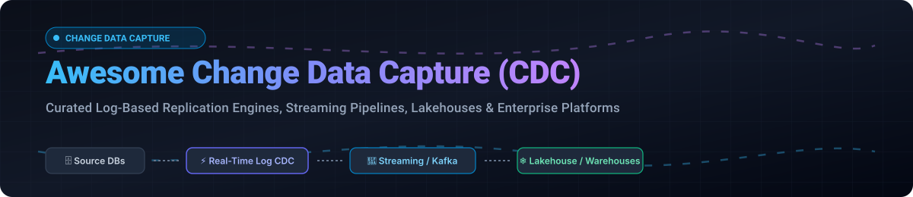

# Awesome Change Data Capture (CDC) ⚡

<div align="center">



<p align="center">
  <a href="https://github.com/ishandutta2007/Awesome-Awesome-Awesome"></a>
  <a href="https://discord.gg/jc4xtF58Ve"></a>
  <a href="https://github.com/ishandutta2007/Awesome-Change-Data-Capture-CDC/stargazers"></a>
  <a href="https://github.com/ishandutta2007/Awesome-Change-Data-Capture-CDC/network/members"></a>
  <a href="https://github.com/ishandutta2007/Awesome-Change-Data-Capture-CDC/blob/main/LICENSE"></a>
  <a href="https://github.com/ishandutta2007"></a>
</p>

**A comprehensive, curated collection of Change Data Capture (CDC) SaaS solutions and open-source GitHub projects.**  
*Empowering data engineering teams with high-throughput log-based replication, real-time streaming ingestion, continuous ETL, schema evolution, and database-to-lakehouse synchronization.*

---

🌟 **Star this repository if you find it helpful!** 🌟

</div>

## 📑 Table of Contents
- [📖 Sector Overview & Market Dynamics](#-sector-overview--market-dynamics)
- [☁️ SaaS & Hosted Platforms](#️-saas--hosted-platforms)
- [🔓 Open-Source GitHub Projects](#-open-source-github-projects)
- [💡 Architectural Patterns & Comparisons](#-architectural-patterns--comparisons)
- [🤝 How to Contribute](#-how-to-contribute)
- [💖 Support](#-support)
- [📈 Star History](#-star-history)
- [⚖️ Disclaimer](#️-disclaimer)

---

## 📖 Sector Overview & Market Dynamics

The global Change Data Capture (CDC) market is estimated at **$2.5 billion** (expanding at an estimated ~25% CAGR toward the broader $10.5+ billion data replication and $15+ billion real-time data integration markets). The sector exhibits **moderate fragmentation with high concentration at the legacy enterprise core**: established cloud hyperscalers and legacy infrastructure providers dominate high-volume mainframe/enterprise relational workloads, while modern cloud-native SaaS platforms, specialized lakehouse ingestion engines, and developer-first open-source frameworks compete intensely for real-time streaming pipelines and AI-readiness architectures.

---

## ☁️ SaaS & Hosted Platforms

The following table evaluates top commercial and managed Change Data Capture platforms, sorted in descending order by company scale (market valuation / parent company enterprise valuation):

| Platform / Vendor | Company Valuation / Scale | Starting Pricing | Free Tier / Free Trial Limits | Best For / Key Features |
| :--- | :--- | :--- | :--- | :--- |
| **[AWS Database Migration Service (DMS)](https://aws.amazon.com/dms/)** | **~$2.1T+** (Amazon Market Cap) | **$0.020–$0.030/hour** (~$15–$22/month baseline `dms.t3.micro` instance) + storage & cross-AZ egress | **750 hours/month** single-AZ `dms.t3.micro` + 50 GB SSD storage for 12 months (or $100 initial usage credits for newer AWS accounts) | Native migration and continuous log-based CDC replication across AWS databases (RDS, Aurora, Redshift, S3) |
| **[StreamSets (IBM)](https://streamsets.com/)** | **~$210B+** (IBM Market Cap; acquired for **$2.3B**) | Starting at **$1,050/VPC/month** (Team tier starting ~$4,200/month for ~12-20 pipelines) | **30-day free trial** (Full platform functionality with drag-and-drop pipeline designer; no permanent free tier) | Visual hybrid/multicloud continuous data integration, complex transformation, and drift handling for enterprise data teams |
| **[Arcion (Databricks)](https://www.databricks.com/)** | **~$134B–$190B** (Databricks Valuation, $4.8B+ ARR; acquired for **$100M+**) | Integrated into Lakeflow Connect starting at **$0.15/DBU** (Classic) / **$0.35/DBU** (Serverless) | **100 DBUs free per day per workspace** for Lakeflow Connect (~100M records/day ingestion limit); 14-day Databricks trial | Real-time agentless CDC from 20+ operational databases (Oracle, Postgres, MySQL) directly into the Databricks Lakehouse |
| **[Snowflake Streams](https://www.snowflake.com/)** | **~$45B–$50B** (Snowflake Market Cap, $3B+ ARR) | Pay-as-you-go consumption starting at **$2.00/credit** (Standard Edition) to **$3.00/credit** (Enterprise) | **$400 in free trial credits** valid for up to **30 days** (No credit card required; no permanent free tier) | In-warehouse CDC tracking table modifications (inserts, updates, deletes) for continuous medallion transformations |
| **[Qlik Replicate](https://www.qlik.com/)** | **~$10B** (Private PE Valuation via Thoma Bravo, ~$750M ARR) | Annual subscription quote based on source/target CPU cores and volume (Enterprise pricing) | **14-day free trial** for Qlik Cloud Data Integration; custom 14–30 day PoC license for client-managed engine | Mission-critical enterprise database and legacy replication from SAP, mainframes, and Oracle into modern analytics stores |
| **[Fivetran HVR](https://www.fivetran.com/)** | **~$5.6B** (Series D Valuation, $300M+ ARR) | Pay-as-you-go starting at **$5.00/month connection minimum** (~$500 per 1M MAR on Standard Plan) | **500,000 Free MAR/month forever** (up to 5,000 model runs/month) + **14-day free trial** for every new connector | High-throughput, log-based replication with zero-impact distributed agent architecture for enterprise workloads |
| **[Striim](https://www.striim.com/)** | **~$250M–$500M** (Valuation, $108M funding raised) | Starting at **$0.60/vCPU-hour** + **$0.50 per 1M events** processed (Striim Cloud) | **14-day free trial**; Developer community tier up to **25 million events/month** | Unified real-time data streaming, in-flight stream processing, and multi-source CDC into cloud targets |
| **[Estuary Flow](https://estuary.dev/)** | **~$68M** (Series A Valuation, $17M funding raised) | **$0.50/GB** volume (capture + delivery) + **$100/month** per connector instance (first 6, then $50/month) | **10 GB/month data volume and 2 connector instances free forever**; free cloud trial | Low-latency streaming SQL transformations with millisecond real-time CDC data synchronization |
| **[Hevo Data](https://hevodata.com/)** | **~$43M funding raised** (~$44M–$47M ARR) | Starter plan starting at **$239–$299/month** (5 million events included) | **1,000,000 events/month free forever** on 50+ free connectors; **14-day free trial** with unlimited events | No-code continuous ETL/ELT pipelines with automated schema mapping and built-in failure recovery |

---

## 🔓 Open-Source GitHub Projects

The following list contains high-performance open-source Change Data Capture engines, connectors, and streaming replication platforms, ranked in descending order by GitHub Stars:

- **[Airbyte](https://github.com/airbytehq/airbyte)** [](https://github.com/airbytehq/airbyte/stargazers)
  - **Overview**: Universal open-source ELT data integration platform with an extensive library of 350+ connectors.
  - **CDC Capabilities**: Native log-based CDC connectors powered under the hood by embedded Debezium engines for Postgres, MySQL, Oracle, and SQL Server.
  - **License**: Elastic License 2.0 / MIT.
  - **Stack**: Java, Python.

- **[Debezium](https://github.com/debezium/debezium)** [](https://github.com/debezium/debezium/stargazers)
  - **Overview**: The battle-tested, de facto open-source industry standard for distributed log-based Change Data Capture.
  - **CDC Capabilities**: Inspects transaction logs across MySQL, PostgreSQL, MongoDB, Oracle, Microsoft SQL Server, IBM Db2, and Cassandra; streams row-level delta events directly to Apache Kafka topics or Kafka Connect runtimes.
  - **License**: Apache-2.0.
  - **Stack**: Java.

- **[Redpanda Connect](https://github.com/redpanda-data/connect)** *(formerly Benthos)* [](https://github.com/redpanda-data/connect/stargazers)
  - **Overview**: High-performance, memory-efficient stream processor and pipeline orchestrator capable of synthesizing, routing, and transforming streaming data.
  - **CDC Capabilities**: Connects to transaction logs and changelog streams with lightweight stateless execution and instant deployment.
  - **License**: Apache-2.0.
  - **Stack**: Go.

- **[Apache Flink CDC](https://github.com/apache/flink-cdc)** [](https://github.com/apache/flink-cdc/stargazers)
  - **Overview**: Next-generation streaming ELT architecture that reads database transaction logs directly within Apache Flink jobs.
  - **CDC Capabilities**: Eliminates the mandatory Kafka message broker layer for database-to-lakehouse syncs (Iceberg, Paimon, Hudi); supports declarative YAML data pipelines, exactly-once snapshot-to-incremental transitions, and upstream SQL filtering.
  - **License**: Apache-2.0.
  - **Stack**: Java.

- **[Zendesk Maxwell](https://github.com/zendesk/maxwell)** [](https://github.com/zendesk/maxwell/stargazers)
  - **Overview**: Lightweight application daemon reading MySQL binlogs and producing JSON change records.
  - **CDC Capabilities**: Streams row-level MySQL events directly to Kafka, Kinesis, RabbitMQ, Redis, Google Cloud Pub/Sub, or standard output with low operational overhead.
  - **License**: Apache-2.0.
  - **Stack**: Java.

- **[LinkedIn Databus](https://github.com/linkedin/databus)** [](https://github.com/linkedin/databus/stargazers)
  - **Overview**: Proven source-agnostic distributed change data capture system built by LinkedIn for sub-millisecond replication.
  - **CDC Capabilities**: Provides partition-aware transaction-ordered stream delivery with rewindable consumer offset positioning.
  - **License**: Apache-2.0.
  - **Stack**: Java.

- **[Apache Paimon](https://github.com/apache/paimon)** [](https://github.com/apache/paimon/stargazers)
  - **Overview**: Unified streaming lakehouse table format tailored for real-time streaming updates and high-speed data ingestion.
  - **CDC Capabilities**: Native streaming changelog production, real-time upsert mechanics, and automated compaction for log-based CDC streams.
  - **License**: Apache-2.0.
  - **Stack**: Java.

- **[PeerDB](https://github.com/PeerDB-io/peerdb)** [](https://github.com/PeerDB-io/peerdb/stargazers)
  - **Overview**: Postgres-first CDC engine designed for ultra-fast replication into Snowflake, ClickHouse, BigQuery, and Kafka.
  - **CDC Capabilities**: Delivers up to 10x faster Postgres replication with native catalog parsing and parallel snapshotting.
  - **License**: Apache-2.0.
  - **Stack**: Go.

- **[Confluent Schema Registry](https://github.com/confluentinc/schema-registry)** [](https://github.com/confluentinc/schema-registry/stargazers)
  - **Overview**: Centralized schema management service providing compatible Avro, JSON Schema, and Protobuf governance for streaming pipelines.
  - **CDC Capabilities**: Guarantees deterministic schema evolution and type safety across heterogeneous CDC event producers and consumers.
  - **License**: Confluent Community License / Apache-2.0.
  - **Stack**: Java.

- **[Apache Cloudberry](https://github.com/apache/cloudberry)** [](https://github.com/apache/cloudberry/stargazers)
  - **Overview**: Advanced open-source massively parallel processing (MPP) analytical database based on PostgreSQL.
  - **CDC Capabilities**: High-throughput parallel CDC stream ingestion and real-time upserts from external databases.
  - **License**: Apache-2.0.
  - **Stack**: C / C++.

- **[Skeema](https://github.com/skeema/skeema)** [](https://github.com/skeema/skeema/stargazers)
  - **Overview**: Declarative schema management system for MySQL and MariaDB with online DDL execution support.
  - **CDC Capabilities**: Integrates alongside CDC pipelines to track, plan, and automate schema evolution without breaking replication topologies.
  - **License**: Apache-2.0.
  - **Stack**: Go.

- **[Estuary Flow Runtime](https://github.com/estuary/flow)** [](https://github.com/estuary/flow/stargazers)
  - **Overview**: Open-source core engine powering Estuary Flow for real-time streaming ELT and CDC connector dispatch.
  - **CDC Capabilities**: Unifies log-based capture with sub-second millisecond replication sinks.
  - **License**: Apache-2.0 / BSL.
  - **Stack**: Rust, TypeScript.

- **[Debezium Server](https://github.com/debezium/debezium-server)** [](https://github.com/debezium/debezium-server/stargazers)
  - **Overview**: Standalone runner for Debezium source connectors without requiring an underlying Kafka Connect cluster.
  - **CDC Capabilities**: Streams transaction events directly to Amazon Kinesis, Google Cloud Pub/Sub, Azure Event Hubs, Redis, Pulsar, or Apache Iceberg sinks.
  - **License**: Apache-2.0.
  - **Stack**: Java.

- **[Kafka Connect JDBC](https://github.com/confluentinc/kafka-connect-jdbc)** [](https://github.com/confluentinc/kafka-connect-jdbc/stargazers)
  - **Overview**: Standard query-based polling connector for JDBC-compatible databases.
  - **CDC Capabilities**: Polls tables based on incrementing IDs and timestamp columns (legacy alternative when binlog/WAL transaction logs are inaccessible).
  - **License**: Confluent Community License.
  - **Stack**: Java.

---

## 💡 Architectural Patterns & Comparisons

Choosing the appropriate Change Data Capture mechanism is the most critical architectural decision in data engineering pipelines:

### 1. Log-Based vs. Query-Based vs. Trigger-Based CDC
* **Log-Based CDC (Recommended for Production)**:
  * *Engines*: Debezium, Flink CDC, PeerDB, Qlik Replicate, Fivetran HVR.
  * *Mechanism*: Directly reads database write-ahead logs (WAL) or binary logs (binlog).
  * *Advantages*: Zero impact on production queries, accurately captures hard `DELETE` operations, preserves full transactional serialization.
* **Query-Based CDC (Fallback Only)**:
  * *Engines*: Kafka Connect JDBC Source.
  * *Mechanism*: Polls databases with polling queries (`WHERE updated_at > :checkpoint`).
  * *Disadvantages*: Cannot detect deleted rows, places heavy recurring load on databases, risks duplicate data on timestamp collisions.
* **Trigger-Based CDC (Avoid for High-Throughput)**:
  * *Mechanism*: Attaches SQL triggers to write delta changes into shadow audit tables.
  * *Disadvantages*: Increases write latency by 2x-5x on application transactions; creates database maintenance locks.

### 2. Multi-Consumer Fanout vs. Direct Lakehouse Sync
```text
[Operational Database] 
         │ (WAL / Binlog)
         ▼
┌───────────────────┐               ┌────────────────────────┐
│  Debezium / Kafka ├──────────────►│ 1 to N Consumer Topics │ (Microservices, Caching, Analytics)
└───────────────────┘               └────────────────────────┘
         ▲
         │ (Alternative Direct Ingestion)
┌───────────────────┐               ┌────────────────────────┐
│     Flink CDC     ├──────────────►│ Iceberg / Paimon Tables│ (Zero-Kafka overhead lakehouse)
└───────────────────┘               └────────────────────────┘
```

---

## 🤝 How to Contribute

Contributions are warmly welcomed! Please follow these steps to add or update tools:

1. 🍴 **Fork** this repository.
2. 🌿 Create a descriptive branch: `git checkout -b add-my-cdc-tool`.
3. ✏️ Update `README.md` adhering strictly to our markdown format:
   - For SaaS products: include starting tier prices and exact free tier/trial limits.
   - For Open-Source: include the repository link, star badge, license, and primary capabilities.
4. 🚀 Submit a Pull Request with a clear summary of your changes.

---

## 💖 Support

If this repository assisted you in evaluating your streaming infrastructure, please consider showing your support:
- ⭐ **Star** this repository on GitHub!
- 🍴 **Fork** and share it with your data engineering peers!
- ☕ **Sponsor**: Buy us a coffee and support continued maintenance at the [Sponsor Dashboard](https://github.com/sponsors/ishandutta2007)!

---

## 📈 Star History

[](https://star-history.dera.page/#ishandutta2007/Awesome-Change-Data-Capture-CDC&type=date&legend=top-left)

---

## ⚖️ Disclaimer

* This repository is a community-curated technical index and does not represent an endorsement.
* Change Data Capture involves continuous streaming of enterprise transactional data: ensure your architecture complies with all data privacy regulations (GDPR, HIPAA, CCPA) and implements stringent end-to-end encryption.
* Vendor pricing and tier offerings are subject to frequent changes; always cross-reference official vendor documentation before making procurement decisions.
